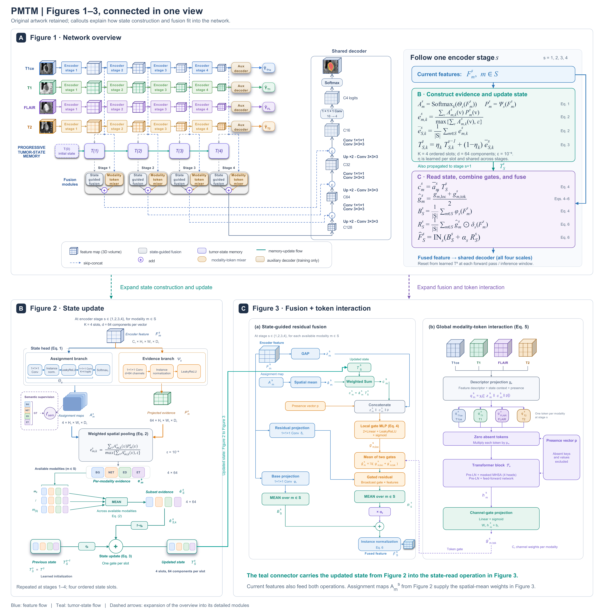

# PMTM

**Progressive multi-scale tumor-state memory for incomplete multimodal brain tumor segmentation**

This repository accompanies the PMTM manuscript.

[arXiv preprint](https://arxiv.org/abs/2610.26457) | [Paper PDF](https://arxiv.org/pdf/2610.26457)

[](assets/pmtm_architecture.pdf)

[View the full-resolution architecture diagram (PDF)](assets/pmtm_architecture.pdf).

## Release status

- **BraTS2020 and BraTS2023 GLI split identifiers:** available as [plain-text subject lists](splits) and in [subject_splits.csv](subject_splits.csv).
- **BraTS2018 split identifiers:** not yet uploaded. The study uses its own 205/23/57 training/validation/test partition; this file does not substitute a published split for it.
- **PMTM source code:** included in this repository. See [Training and evaluation](#training-and-evaluation) and [Training objective](TRAINING.md).
- **Measured per-subject evaluation results:** not distributed with this repository and not planned for public release.

## Installation

Install a CUDA-compatible build of PyTorch in a Python environment, then install
the remaining dependencies:

```bash
python -m pip install -r requirements.txt
```

The implementation retains the Python class name `TSMNet` and some `PMSM`
identifiers for compatibility with the saved checkpoints. PMTM is the manuscript
name of the method.

## Training and evaluation

The MRI channel order is fixed as **T1ce, T1, FLAIR, T2**. Obtain the MRI data
from the relevant BraTS data provider before preprocessing. The preprocessing
entry point is `preprocess_fixed.py`:

```bash
python preprocess_fixed.py --dataset brats2020 --src /path/to/raw_cases --out /path/to/processed
```

The processed dataset contains `vol/<case>_vol.npy` with shape `(H, W, D, 4)`
and `seg/<case>_seg.npy` with shape `(H, W, D)`. Place the fixed train,
validation, and test subject lists in the processed dataset directory. The
saved training configurations expect `train_late15_v6.txt` and
`val_late15_v6.txt`; use the corresponding published train and validation
lists under these filenames, with preprocessing-compatible subject identifiers.
The BraTS2020 published identifiers retain the upstream `HG_` or `LG_` prefix;
the processed filenames must match the identifiers used by the loader.
BraTS2018 subject lists have not yet been released.

The files under `configs/` retain the training arguments from the saved run
configurations confirmed by the authors. Dataset, output, and resume checkpoint
paths are supplied at launch rather than distributed as local machine paths.
Print the command before starting a run:

```bash
python scripts/run_experiment.py --dataset 2020 --datapath /path/to/processed --output-dir /path/to/run --print-command
```

Remove `--print-command` to start training. The launcher supports `2018`,
`2020`, and `2023`. All three configurations use `stage1234`, token mixing at
all active stages, and equal semantic-supervision weights across the four
stages. The training objective is documented in [TRAINING.md](TRAINING.md).

Consistency, cross-stage identity, and slot-diversity losses are optional
regularizers controlled by `lambda_consistency`, `lambda_identity`, and
`lambda_diversity`. Setting a coefficient to `0` disables that loss term.
The supplied configurations enable these regularizers with weights `0.40`,
`0.02`, and `0.005`, respectively. See [Optional regularizers](TRAINING.md#optional-regularizers)
for their definitions and instructions for disabling them.

The saved BraTS2020 run was resumed from an earlier checkpoint. To resume a
run, supply `--resume /path/to/model_last.pth`; otherwise training starts from
initialization. Checkpoints are not included in this source-code release.

Select a checkpoint using validation data, then evaluate the fixed test split:

```bash
python select_checkpoint.py --run_dir /path/to/run --datapath /path/to/processed --val_split val_late15_v6.txt --amp
python evaluate.py --checkpoint /path/to/selected_checkpoint.pth --datapath /path/to/processed --split_file test.txt --output_dir /path/to/evaluation --subsets all --crop_size 128 --overlap 0.5 --amp
```

`evaluate.py` writes measured per-subject scores, subset summaries, and an
overall summary when run with a checkpoint and data. `analyze_states.py`
provides the state-analysis workflow. Use each entry point's `--help` for
its available arguments. The test split is not used for checkpoint selection.

Run the included core tests in an environment with the required dependencies:

```bash
python -m unittest discover -s tests -v
```

## Subject splits

| Dataset | Train | Validation | Test |
|---|---:|---:|---:|
| BraTS2020 | 219 | 50 | 100 |
| BraTS2023 GLI | 875 | 125 | 251 |

`subject_splits.csv` contains one row per subject with columns `dataset`, `split`, and `subject_id`. Identifiers and their order are retained from the upstream lists. BraTS2020 identifiers retain the upstream `HG_` or `LG_` prefix. Train, validation, and test identifiers have no overlap within either dataset, including after removal of that prefix.

The BraTS2020 lists originate from the [official M2FTrans repository](https://github.com/Jun-Jie-Shi/M2FTrans/tree/main/BraTS/BRATS2020_Training_none_npy). The BraTS2023 GLI lists originate from the [public IM-Fuse datalists in MiMoSe](https://github.com/AImageLab-zip/MiMoSe/tree/main/IMFuse/datalist). For the BraTS2023 validation/test CSV files, only the `case` column is used to extract subject membership; the supplied `mask` column is not used to infer PMTM evaluation settings or scores.

See [split_provenance.json](split_provenance.json) for the source paths, pinned source commits, blob hashes, transformations, and validation checks. All six original subject-list files supplied by the manuscript authors matched the pinned public source files byte for byte. The released subject lists are available as `train.txt`, `val.txt`, and `test.txt` in [splits/2020](splits/2020) and [splits/2023](splits/2023), with one subject identifier per line. For BraTS2023 validation and test, only the original CSV `case` column is retained; the header and modality-mask column are removed. Subject membership and ordering are unchanged and match the consolidated CSV.

## Per-subject results template

The header-only [template](per_subject_results_TEMPLATE.csv) is a formatting example for users' own evaluation outputs. It contains no measured scores and does not indicate a planned release of the authors' per-subject results. Populate it only from actual evaluation outputs:

- One row per dataset, subject, method, and evaluated modality subset.
- Use `0` or `1` for each modality-availability column. At least one modality must be available.
- Report the measured WT, TC, and ET Dice scores in percent (0 to 100); do not enter dataset averages as individual-subject values.
- Retain the actual evaluation conventions, including handling of empty target regions, when exporting scores. The template does not define or change those conventions.

The template must not be cited as released evaluation results. Dataset-level table averages cannot reconstruct individual-subject measurements.

## MRI data

The original MRI data are not redistributed in this repository. Access to the BraTS datasets remains subject to the access procedures and terms of the respective data providers. The subject identifiers above are dataset identifiers, not patient names.

## Citation

If you use PMTM or this implementation, please cite the preprint:

```bibtex
@misc{rostamian2026pmtm,
  title = {Progressive multi-scale tumor-state memory for incomplete multimodal brain tumor segmentation},
  author = {Rostamian, Milad and Mohammadi, Mohammadreza and Soryani, Mohsen},
  year = {2026},
  eprint = {2610.26457},
  archivePrefix = {arXiv},
  primaryClass = {eess.IV},
  url = {https://arxiv.org/abs/2610.26457}
}
```
